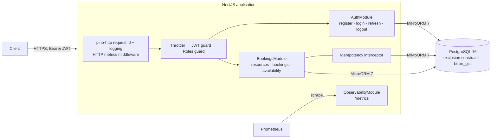

# nest-booking-service

[](https://github.com/milad-codes/nest-booking-service/actions/workflows/ci.yml)


A NestJS + PostgreSQL API for booking shared resources (meeting rooms, desks, equipment).
It is small on purpose, but built the way a production service should be: the hard guarantees
live in the database, every write is safe to retry, and the service is observable.

## What it demonstrates

| Problem                                              | How it is solved                                                                                                                                                                                                          |
| ---------------------------------------------------- | ------------------------------------------------------------------------------------------------------------------------------------------------------------------------------------------------------------------------- |
| Two people book the same room at the same time       | A PostgreSQL **exclusion constraint** on `(resource_id, tstzrange(starts_at, ends_at))` rejects overlaps atomically. No check-then-insert race; 10 concurrent requests for one slot produce exactly one booking (tested). |
| A client retries after a timeout and books twice     | `Idempotency-Key` on `POST /bookings`: the first successful response is stored and replayed; a reused key with a different body is rejected.                                                                              |
| A stolen refresh token keeps a session alive forever | Refresh tokens are single-use and rotated; replaying an old one **revokes the whole token family**. Only SHA-256 hashes are stored.                                                                                       |
| Concurrent edits overwrite each other                | `ETag` / `If-Match` with an optimistic-lock version on cancellation.                                                                                                                                                      |
| "Why is it slow?" / "Why so many 409s?"              | JSON logs with request ids, Prometheus metrics per route template, domain counters.                                                                                                                                       |
| Errors are inconsistent                              | Every error is an RFC 9457 `application/problem+json` document with a `requestId`.                                                                                                                                        |

## Architecture



Design decisions are recorded as ADRs:
[0001 overlap prevention in the database](docs/adr/0001-prevent-overlaps-in-the-database.md) ·
[0002 idempotency keys](docs/adr/0002-idempotency-keys.md) ·
[0003 refresh token rotation](docs/adr/0003-refresh-token-rotation.md)

## API

Interactive docs: `http://localhost:3000/docs` (OpenAPI JSON at `/docs/openapi.json`).

| Method       | Path                                  | Who           | Notes                                                          |
| ------------ | ------------------------------------- | ------------- | -------------------------------------------------------------- |
| POST         | `/auth/register`, `/auth/login`       | public        | returns an access token (15 min) and a refresh token           |
| POST         | `/auth/refresh`                       | public        | single-use rotation; reuse revokes the session                 |
| POST         | `/auth/logout`                        | public        | revokes the session (idempotent)                               |
| GET          | `/users/me`                           | member        |                                                                |
| GET          | `/resources`                          | member        | admins can add `?includeInactive=true`                         |
| POST / PATCH | `/resources`, `/resources/:id`        | admin         |                                                                |
| GET          | `/resources/:id/availability?from&to` | member        | busy intervals only, no user data                              |
| POST         | `/bookings`                           | member        | `Idempotency-Key` supported; 409 `BOOKING_OVERLAP` on conflict |
| GET          | `/bookings?limit&cursor&scope`        | member        | keyset pagination; `scope=all` for admins                      |
| GET          | `/bookings/:id`                       | owner / admin | `ETag` = version                                               |
| POST         | `/bookings/:id/cancel`                | owner / admin | honours `If-Match`                                             |
| GET          | `/health/live`, `/health/ready`       | public        | readiness checks the database                                  |
| GET          | `/metrics`                            | Prometheus    | bearer token if `METRICS_TOKEN` is set                         |

```bash
# book a room (the period is half-open: [startsAt, endsAt))
curl -X POST localhost:3000/bookings \
  -H "Authorization: Bearer $TOKEN" -H 'Content-Type: application/json' \
  -H "Idempotency-Key: $(uuidgen)" \
  -d '{"resourceId":"…","startsAt":"2030-01-07T09:00:00Z","endsAt":"2030-01-07T10:00:00Z"}'
```

## Run it

```bash
docker compose up --build        # API on :3000, PostgreSQL with a volume, migrations on start
```

Local development (Node 22, PostgreSQL 16):

```bash
cp .env.example .env             # adjust DATABASE_URL and JWT_ACCESS_SECRET
npm ci
npm run start:dev
```

In production, run migrations as a release step (`node dist/database/migrate.js`) instead of `MIGRATE_ON_START`.

### Configuration

| Variable                 | Default |                                              |
| ------------------------ | ------- | -------------------------------------------- |
| `DATABASE_URL`           | —       | `postgresql://…` (required)                  |
| `JWT_ACCESS_SECRET`      | —       | ≥ 32 characters (required)                   |
| `JWT_ACCESS_TTL_SECONDS` | `900`   | access token lifetime                        |
| `REFRESH_TOKEN_TTL_DAYS` | `30`    |                                              |
| `BOOTSTRAP_ADMIN_EMAIL`  | —       | this email becomes `admin` on registration   |
| `MIGRATE_ON_START`       | `false` |                                              |
| `RATE_LIMIT_PER_MINUTE`  | `120`   | per client, all routes except probes/metrics |
| `METRICS_TOKEN`          | —       | protects `/metrics` when set                 |
| `LOG_LEVEL`              | `info`  |                                              |
| `PORT`                   | `3000`  |                                              |

Invalid configuration fails at boot with every problem listed.

## Tests

```bash
npm test                 # unit tests
npm run test:e2e         # end-to-end against a real PostgreSQL (DATABASE_URL)
```

CI runs lint, format check, typecheck, unit tests with coverage, the e2e suite against PostgreSQL 16,
and builds the container image and starts it against a database until `/health/ready` answers.

## Project layout

```
src/
  auth/            JWT + refresh rotation, guards, decorators
  bookings/        bookings, period rules
  resources/       resources, availability
  common/          problem+json filter, idempotency, ids
  observability/   logging, metrics
  database/        MikroORM config, migrations, migrate script
test/unit, test/e2e
docs/adr           architecture decision records
```

## Limits and next steps

- Idempotency records expire after 24 h and are purged lazily; a scheduled purge is a follow-up.
- HS256 access tokens assume one verifying service; asymmetric keys if that changes.
- No recurring bookings or time-zone-aware business hours yet.

## License

MIT
