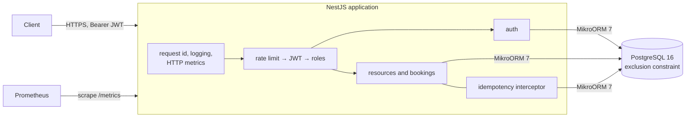

# nest-booking-service

[](https://github.com/milad-codes/nest-booking-service/actions/workflows/ci.yml)
[](https://github.com/milad-codes/nest-booking-service/releases)
[](LICENSE)

A booking API for shared resources such as meeting rooms, desks or equipment, built with NestJS and PostgreSQL.

## The problem

A booking system looks simple until two people reserve the same room in the same second. Three things then usually go wrong:

- an application-level "is it free?" check lets both requests through;
- a client that times out and retries books twice;
- a leaked refresh token keeps a session alive indefinitely.

This service handles those three cases deliberately and tests them against a real database.

**In scope:** accounts (register, login, refresh, logout); resources managed by admins; bookings (create, list, view, cancel); availability; OpenAPI docs; logs and metrics.
**Out of scope:** recurring bookings, time zones and business hours, notifications, multi-tenancy, email verification and password reset.

## Design decisions

| Decision                                                                                                                   | Why                                                                                                                                                    | Trade-off                                                                                              |
| -------------------------------------------------------------------------------------------------------------------------- | ------------------------------------------------------------------------------------------------------------------------------------------------------ | ------------------------------------------------------------------------------------------------------ |
| Overlaps are rejected by a PostgreSQL exclusion constraint ([ADR 0001](docs/adr/0001-prevent-overlaps-in-the-database.md)) | The insert itself is the check, so concurrent requests can't both win. A test sends 10 parallel requests for one slot and expects exactly one booking. | PostgreSQL-specific (`btree_gist`). Conflicts arrive as database errors that the API has to translate. |
| `Idempotency-Key` on `POST /bookings`, stored per user ([ADR 0002](docs/adr/0002-idempotency-keys.md))                     | A retried request returns the first response instead of booking twice.                                                                                 | One extra write per request. Only successful responses are replayed. Keys expire after 24 hours.       |
| Single-use refresh tokens with reuse detection ([ADR 0003](docs/adr/0003-refresh-token-rotation.md))                       | Replaying an old refresh token revokes the whole session family. Only SHA-256 hashes are stored.                                                       | A refresh needs a database round trip. Reuse logs out every device in that family.                     |
| Optimistic locking on cancel (`version`, `ETag`, `If-Match`)                                                               | Prevents lost updates. When two cancellations race, the database version check decides.                                                                | Clients have to handle `412 Precondition Failed`.                                                      |
| Keyset pagination with opaque cursors                                                                                      | Pages stay stable while bookings are added.                                                                                                            | No jumping to page N. A cursor only works with the sort order that produced it.                        |



## Run it with Docker

```bash
docker compose up --build      # API on http://localhost:3000, PostgreSQL 16 with a volume, migrations on start
npm run demo                   # in a second terminal (Node 22, no install needed): a walkthrough with synthetic data
```

The demo signs in as the bootstrap admin (`admin@example.com` in `docker-compose.yml`) and creates two synthetic members and a room. It then shows:

- a booking, and an idempotent retry of it
- a rejected overlapping booking
- busy intervals without names
- a cancellation with `If-Match`, then a stale second attempt
- the freed slot being booked again

```text
✓ Ada books 09:00-10:00 UTC tomorrow: 201
✓ Ada's client retries with the same Idempotency-Key (replayed: true): 201
✓ Grace tries 09:30-10:30 (overlaps): 409 (The requested period overlaps an existing booking for this resource)
✓ Ada cancels with If-Match "1": 200
✓ a second cancel with the old ETag: 412 (Booking has version 2, not 1)
```

Interactive API docs are at `http://localhost:3000/docs`.

## Run it locally

You need Node 22.17 or newer and PostgreSQL 16. The `btree_gist` extension ships with PostgreSQL, and the migration creates it.

```bash
cp .env.example .env           # set DATABASE_URL and a JWT_ACCESS_SECRET of at least 32 characters
npm ci
npm run start:dev              # reads .env; MIGRATE_ON_START=true applies migrations at boot
```

`npm start`, `npm run start:dev` and `npm run db:migrate` read `.env` if it exists. Real environment variables take precedence. In a deployment, run `npm run db:migrate` as a release step instead of `MIGRATE_ON_START`.

### Configuration

| Variable                 | Default |                                                                                         |
| ------------------------ | ------- | --------------------------------------------------------------------------------------- |
| `DATABASE_URL`           | —       | required                                                                                |
| `JWT_ACCESS_SECRET`      | —       | required, at least 32 characters                                                        |
| `JWT_ACCESS_TTL_SECONDS` | `900`   | access-token lifetime                                                                   |
| `REFRESH_TOKEN_TTL_DAYS` | `30`    |                                                                                         |
| `BOOTSTRAP_ADMIN_EMAIL`  | —       | the account registered with this email becomes `admin` (see [SECURITY.md](SECURITY.md)) |
| `MIGRATE_ON_START`       | `false` |                                                                                         |
| `RATE_LIMIT_PER_MINUTE`  | `120`   | per client IP and process; probes and metrics are exempt                                |
| `METRICS_TOKEN`          | —       | when set, `/metrics` requires it as a bearer token                                      |
| `LOG_LEVEL`              | `info`  |                                                                                         |
| `PORT`                   | `3000`  |                                                                                         |

Invalid configuration stops the service at boot and lists every problem.

## API

| Method       | Path                                  | Who            | Notes                                                          |
| ------------ | ------------------------------------- | -------------- | -------------------------------------------------------------- |
| POST         | `/auth/register`, `/auth/login`       | public         | access token (15 min) and refresh token                        |
| POST         | `/auth/refresh`                       | public         | single use; reusing an old token revokes the session           |
| POST         | `/auth/logout`                        | public         | revokes the session; safe to repeat                            |
| GET          | `/users/me`                           | member         |                                                                |
| GET          | `/resources`                          | member         | admins can add `?includeInactive=true`                         |
| POST / PATCH | `/resources`, `/resources/:id`        | admin          |                                                                |
| GET          | `/resources/:id/availability?from&to` | member         | busy intervals only, no user data                              |
| POST         | `/bookings`                           | member         | `Idempotency-Key` supported; `409 BOOKING_OVERLAP` on conflict |
| GET          | `/bookings?limit&cursor&scope`        | member         | keyset pagination; `scope=all` for admins                      |
| GET          | `/bookings/:id`                       | owner or admin | `ETag` carries the version                                     |
| POST         | `/bookings/:id/cancel`                | owner or admin | `If-Match` with a version or `*`                               |
| GET          | `/health/live`, `/health/ready`       | public         | readiness checks the database                                  |
| GET          | `/metrics`                            | Prometheus     |                                                                |

Periods are half-open, `[startsAt, endsAt)`, so 09:00–10:00 and 10:00–11:00 don't overlap. Bookings last between 15 minutes and 12 hours, must start in the future and are stored in UTC. Errors are RFC 9457 `application/problem+json` documents with a `requestId`.

## Tests

```bash
npm test                       # unit tests
npm run test:e2e               # end-to-end tests against PostgreSQL (DATABASE_URL)
```

⚠ The end-to-end suite **drops and recreates the `public` schema** of the database in `DATABASE_URL`. Point it at a scratch database.

The end-to-end tests boot the real application against PostgreSQL. They cover:

- the concurrency cases: parallel bookings for one slot, parallel cancellations with and without `If-Match`
- idempotent retries
- refresh-token reuse
- pagination, metrics and the OpenAPI document

CI runs lint, the format check, typecheck, unit tests, the end-to-end suite on PostgreSQL 16, and a container build. The container build starts the image against a database and waits for `/health/ready`.

## Troubleshooting

| Symptom                                                 | Cause and fix                                                                                                                             |
| ------------------------------------------------------- | ----------------------------------------------------------------------------------------------------------------------------------------- |
| `Invalid configuration: …` at start                     | A required variable is missing. Copy `.env.example` to `.env`, or export the variables. `JWT_ACCESS_SECRET` needs at least 32 characters. |
| `connect ECONNREFUSED 127.0.0.1:5432`                   | PostgreSQL isn't running, or `DATABASE_URL` points elsewhere. With Docker, use `docker compose up`.                                       |
| `permission denied to create extension "btree_gist"`    | The migration's role can't create extensions. Run `CREATE EXTENSION btree_gist;` once as the database owner or a superuser.               |
| `401` on every request                                  | The access token expired (15 minutes by default). Call `/auth/refresh` with the refresh token.                                            |
| `409 BOOKING_OVERLAP`                                   | Expected: the slot is taken. `GET /resources/:id/availability` shows busy intervals.                                                      |
| `409` "still being processed" with an `Idempotency-Key` | A request with that key is in flight, or a crash interrupted it (see limitations). Use a new key for a new booking.                       |
| `429 Too Many Requests`                                 | `RATE_LIMIT_PER_MINUTE` was reached for your IP.                                                                                          |

## Limitations

- No load tests and no throughput figures. Correctness under concurrency is tested; capacity isn't.
- The rate limit is held in process memory. Several instances would each allow the full rate.
- Access tokens use HS256 with a shared secret, which suits a single service that verifies its own tokens.
- If the process dies after a booking commits but before its idempotency record is completed, retries with that key get `409` until the key expires after 24 hours. The booking itself exists.
- Expired idempotency records are deleted only when the same key is used again. There's no scheduled cleanup.
- No email verification, password reset or account lockout beyond the rate limit.

## Project layout

```text
src/
  auth/            tokens, refresh rotation, guards
  bookings/        bookings, period rules, cursor validation
  resources/       resources and availability
  common/          problem+json filter, idempotency, ids
  observability/   logging, metrics
  database/        MikroORM config, migrations, migrate script
scripts/demo.mjs   API walkthrough with synthetic data
test/unit, test/e2e
docs/adr/          architecture decision records
```

Changes are listed in [CHANGELOG.md](CHANGELOG.md), and releases are on the [releases page](https://github.com/milad-codes/nest-booking-service/releases).

## Security and licence

See [SECURITY.md](SECURITY.md) for how to report a problem and what to check before deploying. Released under the [MIT licence](LICENSE).
